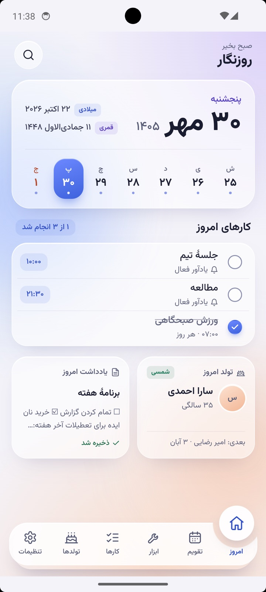
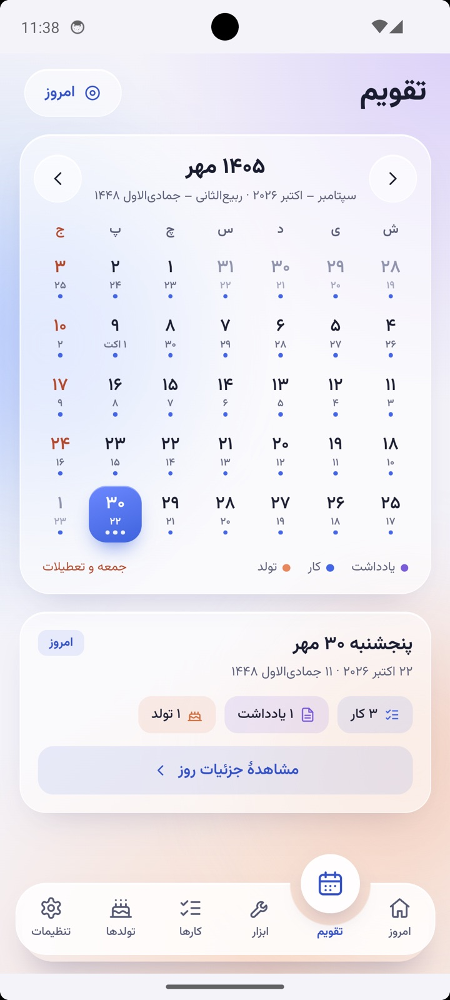
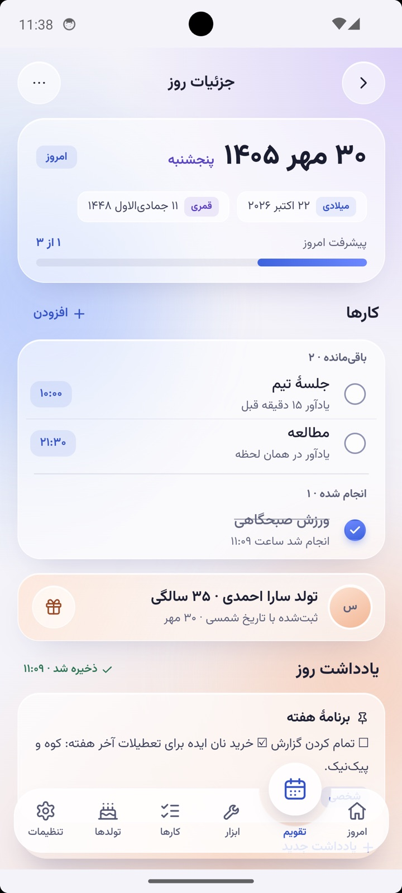
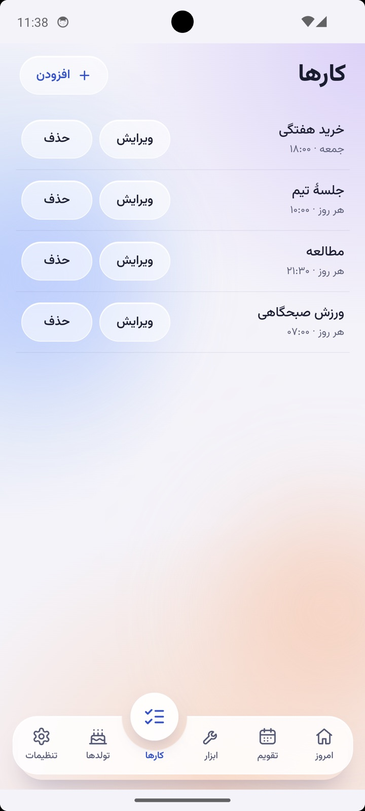
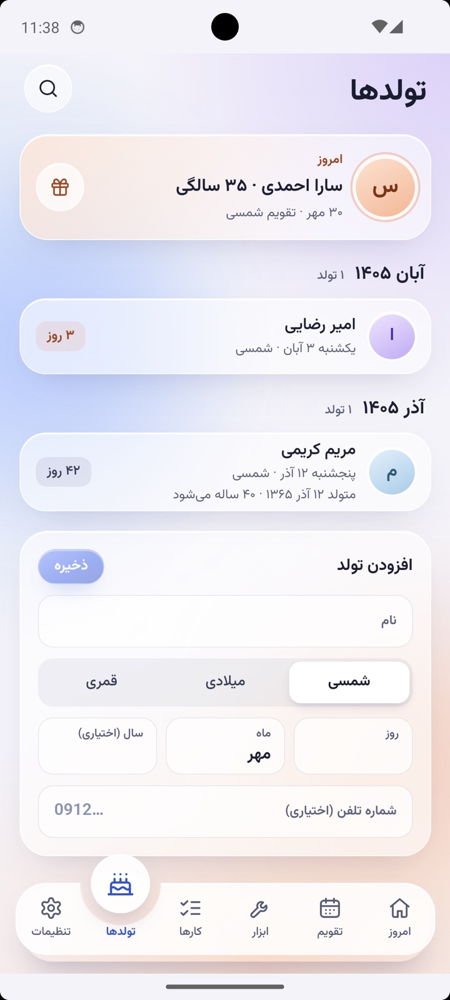
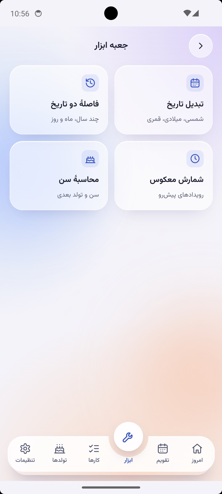
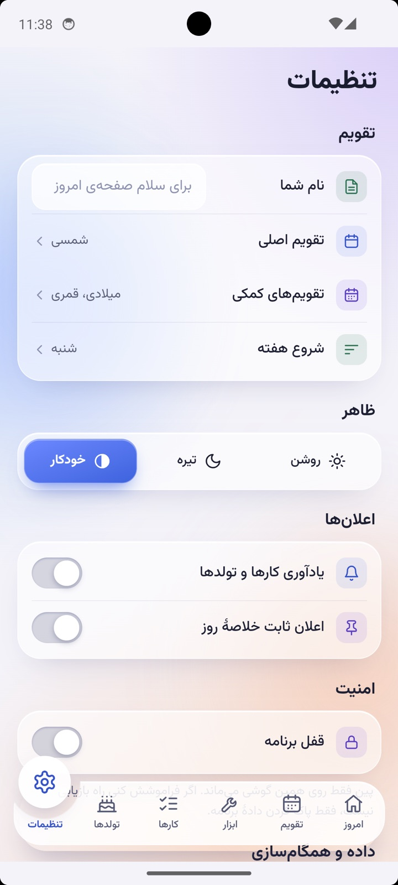

<div align="center">

# روزنگار

**تقویم فارسی، آفلاین و بدون دردسر**

شمسی، میلادی و قمری — کارها، یادداشت‌ها و تولدها، همه روی گوشی خودت.




</div>

---

## چرا روزنگار؟

- **سه تقویم کنار هم** — تاریخ شمسی، میلادی و قمری با هم دیده می‌شوند؛ اختلاف قمری هم قابل تنظیم است.
- **همیشه آفلاین** — تمام داده‌ها در IndexedDB دستگاه می‌مانند. برنامه بدون اینترنت کامل کار می‌کند.
- **کارهای تکرارشونده** — روزهای هفته، ساعت، یادآور و پیشرفت روزانه.
- **یادداشت‌های روزانه** — برای هر روز بنویس، سنجاق کن و جست‌وجو کن.
- **تولدها** — سن، تولد بعدی و یادآوری، با پشتیبانی از هر سه تقویم.
- **جست‌وجوی سراسری** — میان یادداشت‌ها، کارها و تولدها.
- **جعبه‌ابزار** — تبدیل تاریخ، فاصلهٔ دو تاریخ، محاسبهٔ سن و شمارش معکوس.
- **حریم خصوصی** — قفل برنامه با پین یا اثر انگشت، بدون هیچ سرور اجباری.
- **ویجت اندروید** — تاریخ و کارهای امروز روی صفحهٔ اصلی.
- **همگام‌سازی اختیاری** — اگر خودت بخواهی، با Cloudflare Workers و D1.

---

## تصاویر برنامه

| امروز | تقویم | جزئیات روز |
|:---:|:---:|:---:|
|  |  |  |

| کارها | تولدها | ابزارها |
|:---:|:---:|:---:|
|  |  |  |

<div align="center">

</div>

---

## اجرا

نیاز به **Node 22** دارد. اگر `fnm` داری، دستورها را با `fnm exec --using=22` اجرا کن.

```bash
pnpm install
pnpm dev        # سرور توسعه
pnpm test       # تست‌ها
pnpm build      # خروجی production
```

## ساخت اندروید

```bash
pnpm android:apk      # APK دیباگ
pnpm android:release  # APK امضاشده → release/taghvim.apk
```

> ⚠️ **مهم:** از `android/release.keystore` و `android/keystore.properties` نسخهٔ پشتیبان نگه دار. بدون آن‌ها نسخهٔ نصب‌شده روی گوشی هیچ‌وقت قابل به‌روزرسانی نیست.

## همگام‌سازی (اختیاری)

بدون `VITE_SYNC_URL` هیچ بخش همگام‌سازی وجود ندارد و برنامه به شبکه دست نمی‌زند.

```bash
pnpm exec wrangler login
pnpm exec wrangler d1 create taghvim          # database_id را در wrangler.jsonc بگذار
pnpm exec wrangler d1 migrations apply taghvim --remote
pnpm build && pnpm exec wrangler deploy
```

سپس آدرس Worker را در `.env.production` قرار بده و دوباره APK بساز:

```env
VITE_SYNC_URL=https://taghvim.<you>.workers.dev
```

ورود به بخش همگام‌سازی در تنظیمات مخفی است: پنج بار روی عنوان «تنظیمات» بزن. بدون کد دعوت، با ایمیل و رمز می‌توانی حساب بسازی؛ سرور فقط هش کلید مشتق‌شده را نگه می‌دارد.

## تست سرور

```bash
pnpm exec wrangler dev --port 8799
node scripts/smoke-sync.mjs http://127.0.0.1:8799
```

---

<div align="center">

ساخته‌شده برای فارسی‌زبان‌ها — با ❤️

</div>
